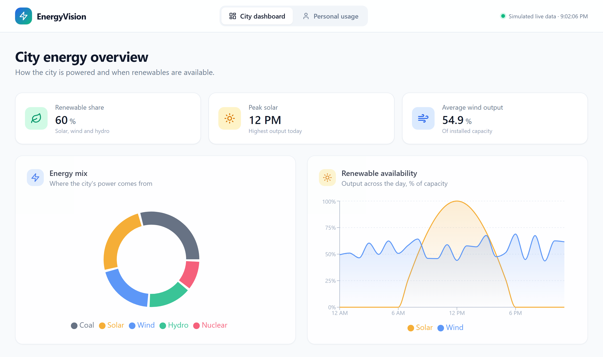

<div align="center">

# ⚡ EnergyVision

**An interactive energy dashboard built with React and strict TypeScript.**

See how a city is powered, when renewables are available, how much energy a household uses, and what it would take to go solar.

[](https://github.com/fullsendit-sj235/Website/actions/workflows/ci.yml)


</div>



<details>
<summary><strong>Personal usage view</strong></summary>


</details>

## Features

- **City dashboard:** energy mix by source, renewable share, and solar/wind output across the day
- **Personal usage:** daily usage, weekly consumption, and an annual carbon footprint broken down by source
- **Solar sizing calculator:** sliders for daily usage and sunlight hours that size the panel area and battery in real time
- **Recommendations:** upgrade options with upfront cost, savings and payback period, plus low-cost efficiency tips
- **Live updates:** data refreshes every 5 seconds from a seeded simulator
- **Linkable views:** each tab has its own URL (`/#city`, `/#personal`) and works with the back button
- **Accessible:** WAI-ARIA tabs with arrow-key navigation, labelled form controls, and screen-reader labels for charts
- **Responsive:** works from phone to widescreen

> All figures are simulated for demonstration. The data layer sits behind an interface, so a real API can replace the simulator without touching the UI.

## TypeScript highlights

The project runs with `strict` plus `noUncheckedIndexedAccess`, `exactOptionalPropertyTypes`, `noImplicitReturns` and `noImplicitOverride`, and is linted with typescript-eslint's **`strictTypeChecked`** rules.

**Exhaustive discriminated unions.** Recommendations are either an investment or a list of tips. The renderer switches on `kind`, and `assertNever` makes adding a third variant a compile error until it is handled.

```ts
export type Recommendation = InvestmentRecommendation | TipsRecommendation;

switch (recommendation.kind) {
  case 'investment': /* cost, savings, payback */
  case 'tips': /* checklist */
  default:
    return assertNever(recommendation);
}
```

**Types derived from data.** Domain values are declared once as `as const` tuples, and their types are derived from them. Lookup tables use `satisfies` so the compiler checks that every source has a style.

```ts
export const ENERGY_SOURCES = ['coal', 'solar', 'wind', 'hydro', 'nuclear'] as const;
export type EnergySource = (typeof ENERGY_SOURCES)[number];

export const ENERGY_SOURCE_STYLES = {
  coal: { label: 'Coal', color: '#475569' },
  // ...
} as const satisfies Record<EnergySource, SourceStyle>;
```

**Generic, type-safe utilities.** `peakHour` only accepts keys whose values are numbers, using a mapped type:

```ts
export type NumericKeys<T> = {
  [K in keyof T]-?: T[K] extends number ? K : never;
}[keyof T];

peakHour(series, 'solar'); // ✅
peakHour(series, 'hour'); // ✅
peakHour(series, 'label'); // ❌ compile error, not a numeric field
```

**Generic components.** `Header<Id>` is generic over the tab ids, so `onTabChange` receives the exact union (`'city' | 'personal'`), not `string`.

## Architecture

```
src/
├── types/        Domain types: energy sources, snapshots, unit aliases (kWh, kg, %)
├── lib/          Pure, framework-free logic, fully unit-tested
│   ├── energy.ts     Carbon, mix percentages, solar sizing, payback, peak detection
│   ├── random.ts     Seeded PRNG (mulberry32) for reproducible simulations
│   └── format.ts     Intl-based number, currency, time and hour formatting
├── data/         Data sources and static content
│   ├── energySource.ts   EnergyDataSource interface and the seeded simulator
│   ├── recommendations.ts
│   └── sources.ts        Display labels and colours per source
├── hooks/        useEnergyData (polling), useHashState (URL-synced tab)
├── components/   Charts, calculator, cards, and ui/ primitives (Card, StatTile)
├── views/        CityDashboard and PersonalUsage, lazy-loaded per tab
└── App.tsx       Layout, tab routing and Suspense boundary
```

Data flows one way: an **`EnergyDataSource`** produces immutable **`EnergySnapshot`**s, **`useEnergyData`** polls it, and the views render from the latest snapshot. Calculations live in `lib/` as pure functions, so they are tested without rendering anything.

```ts
export interface EnergyDataSource {
  initial(): EnergySnapshot;
  next(previous: EnergySnapshot): EnergySnapshot;
}
```

**Performance:** each view is code-split with `React.lazy`, and Recharts, React and Framer Motion are split into separate vendor chunks, so the initial app chunk is about 10 KB.

## Getting started

Requires **Node.js 20+**.

```bash
git clone https://github.com/fullsendit-sj235/Website.git
cd Website
npm install
npm run dev
```

Then open http://localhost:5173.

## Scripts

| Command                 | What it does                                      |
| ----------------------- | ------------------------------------------------- |
| `npm run dev`           | Start the Vite dev server with hot reload         |
| `npm run build`         | Typecheck, then build for production into `dist/` |
| `npm run preview`       | Serve the production build locally                |
| `npm run typecheck`     | Run the TypeScript compiler                       |
| `npm run lint`          | ESLint with type-aware strict rules               |
| `npm run format`        | Format with Prettier (`format:check` to verify)   |
| `npm test`              | Run the test suite once (`test:watch` to watch)   |
| `npm run test:coverage` | Run tests with a V8 coverage report               |
| `npm run check`         | Typecheck, lint, format check and tests in one go |

## Testing

37 tests across the logic, data and UI layers, using **Vitest** and **React Testing Library**:

- **Unit tests** for every calculation, including edge cases: division by zero, negative inputs, and payback that never happens
- **Data tests** that check the simulator's invariants: a 24-hour series, a mix that sums to 100%, and identical output for the same seed
- **Component tests** that drive the UI the way a user would: moving sliders, clicking tabs, arrow-key navigation, and URL hash routing

GitHub Actions runs typecheck, lint, format check, tests with coverage, and a production build on every push and pull request.

## Roadmap

- Replace the simulator with a real API client (e.g. Open-Meteo for solar radiation and wind)
- Let users enter their own usage instead of sample data
- Dark mode
